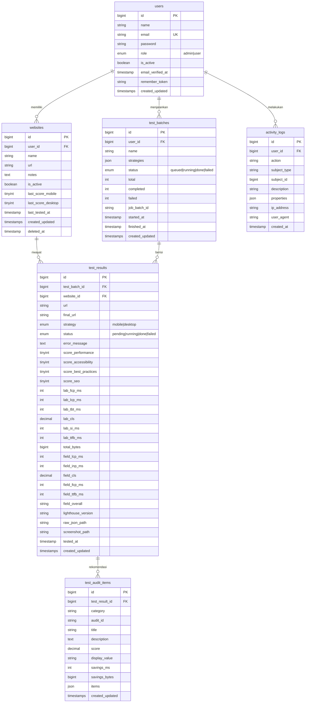

# ERD.md — Rancangan Database

Rancangan database sederhana untuk **PageSpeed Monitor** (Laravel 13 + MySQL 8).

> Dokumen terkait: [PROJECT.md](PROJECT.md) · [API.md](API.md)

---

## 1. Ringkasan Tabel

| Tabel | Fungsi |
|---|---|
| `users` | Akun login (admin / user) |
| `websites` | Website yang disimpan agar bisa dites tanpa input URL ulang |
| `test_batches` | Satu kali klik "Jalankan Test" (bisa berisi banyak website) |
| `test_results` | **Riwayat**: satu hasil test per website × strategi |
| `test_audit_items` | Rekomendasi / audit yang gagal untuk setiap hasil |
| `activity_logs` | Log audit aktivitas pengguna |

Tabel bawaan Laravel yang juga dipakai: `password_reset_tokens`, `sessions`, `cache`, `cache_locks`, `jobs`, `job_batches`, `failed_jobs`.

---

## 2. Diagram



### Versi teks

```
users ─┬─< websites ─────────────< test_results >───── test_batches >─┬─ users
       │                                │                              │
       │                                └─< test_audit_items           │
       └─< activity_logs                                               │
       └───────────────────────────────────────────────────────────────┘
```

---

## 3. Relasi

| Relasi | Tipe | Keterangan |
|---|---|---|
| `users` → `websites` | 1 : N | Satu user punya banyak website |
| `users` → `test_batches` | 1 : N | User yang menekan tombol test |
| `users` → `activity_logs` | 1 : N | Pelaku aktivitas |
| **`websites` → `test_results`** | **1 : N** | **Riwayat test sebuah website** |
| `test_batches` → `test_results` | 1 : N | Semua hasil dari satu kali jalan |
| `test_results` → `test_audit_items` | 1 : N | Rekomendasi per hasil |
| `activity_logs` → apa saja | polimorfik | `subject_type` + `subject_id` |

### Contoh Eloquent

```php
// Website.php
public function user()        { return $this->belongsTo(User::class); }
public function results()     { return $this->hasMany(TestResult::class); }
public function latestResult(){ return $this->hasOne(TestResult::class)->latestOfMany('tested_at'); }

// TestBatch.php
public function user()        { return $this->belongsTo(User::class); }
public function results()     { return $this->hasMany(TestResult::class); }

// TestResult.php
public function website()     { return $this->belongsTo(Website::class)->withTrashed(); }
public function batch()       { return $this->belongsTo(TestBatch::class, 'test_batch_id'); }
public function auditItems()  { return $this->hasMany(TestAuditItem::class); }

// ActivityLog.php
public function user()        { return $this->belongsTo(User::class); }
public function subject()     { return $this->morphTo(); }
```

---

## 4. Detail Tabel

### 4.1 `users`

| Kolom | Tipe | Null | Default | Keterangan |
|---|---|:---:|---|---|
| id | BIGINT UNSIGNED PK | | AI | |
| name | VARCHAR(255) | | | |
| email | VARCHAR(255) UNIQUE | | | |
| email_verified_at | TIMESTAMP | ✓ | | |
| password | VARCHAR(255) | | | hash bcrypt |
| role | ENUM('admin','user') | | `user` | |
| is_active | BOOLEAN | | `1` | user nonaktif tidak bisa login |
| remember_token | VARCHAR(100) | ✓ | | |
| created_at, updated_at | TIMESTAMP | ✓ | | |

### 4.2 `websites`

| Kolom | Tipe | Null | Default | Keterangan |
|---|---|:---:|---|---|
| id | BIGINT UNSIGNED PK | | AI | |
| user_id | BIGINT UNSIGNED FK → users.id | | | pemilik |
| name | VARCHAR(150) | | | nama tampilan, mis. "Toko Online" |
| url | VARCHAR(2048) | | | URL lengkap `https://...` |
| notes | TEXT | ✓ | | catatan bebas |
| is_active | BOOLEAN | | `1` | sembunyikan dari pilihan test jika 0 |
| last_score_mobile | TINYINT UNSIGNED | ✓ | | cache skor performa terakhir |
| last_score_desktop | TINYINT UNSIGNED | ✓ | | cache skor performa terakhir |
| last_tested_at | TIMESTAMP | ✓ | | |
| created_at, updated_at | TIMESTAMP | ✓ | | |
| deleted_at | TIMESTAMP | ✓ | | **soft delete**, agar riwayat tidak hilang |

Index: `user_id`, unik `(user_id, url_hash)`.

> URL bisa sampai 2048 karakter sehingga tidak bisa langsung di-index unik di MySQL. Tambahkan kolom `url_hash CHAR(64)` berisi `hash('sha256', $url)` untuk constraint unik.

### 4.3 `test_batches`

| Kolom | Tipe | Null | Default | Keterangan |
|---|---|:---:|---|---|
| id | BIGINT UNSIGNED PK | | AI | |
| user_id | BIGINT UNSIGNED FK → users.id | | | yang menjalankan |
| name | VARCHAR(150) | ✓ | | opsional, mis. "Cek mingguan" |
| strategies | JSON | | | `["mobile","desktop"]` |
| status | ENUM('queued','running','done','failed') | | `queued` | |
| total | INT UNSIGNED | | `0` | jumlah test_results |
| completed | INT UNSIGNED | | `0` | yang selesai |
| failed | INT UNSIGNED | | `0` | yang gagal |
| job_batch_id | VARCHAR(36) | ✓ | | id dari tabel `job_batches` |
| started_at | TIMESTAMP | ✓ | | |
| finished_at | TIMESTAMP | ✓ | | |
| created_at, updated_at | TIMESTAMP | ✓ | | |

Index: `user_id`, `status`.

### 4.4 `test_results` (riwayat)

| Kolom | Tipe | Null | Keterangan |
|---|---|:---:|---|
| id | BIGINT UNSIGNED PK | | |
| test_batch_id | BIGINT UNSIGNED FK → test_batches.id | | |
| website_id | BIGINT UNSIGNED FK → websites.id | | **relasi ke website tersimpan** |
| url | VARCHAR(2048) | | snapshot URL saat dites (website bisa diedit nanti) |
| final_url | VARCHAR(2048) | ✓ | URL setelah redirect |
| strategy | ENUM('mobile','desktop') | | |
| status | ENUM('pending','running','done','failed') | | default `pending` |
| error_message | TEXT | ✓ | |
| score_performance | TINYINT UNSIGNED | ✓ | 0–100 |
| score_accessibility | TINYINT UNSIGNED | ✓ | 0–100 |
| score_best_practices | TINYINT UNSIGNED | ✓ | 0–100 |
| score_seo | TINYINT UNSIGNED | ✓ | 0–100 |
| lab_fcp_ms | INT UNSIGNED | ✓ | First Contentful Paint |
| lab_lcp_ms | INT UNSIGNED | ✓ | Largest Contentful Paint |
| lab_tbt_ms | INT UNSIGNED | ✓ | Total Blocking Time |
| lab_cls | DECIMAL(6,4) | ✓ | Cumulative Layout Shift |
| lab_si_ms | INT UNSIGNED | ✓ | Speed Index |
| lab_ttfb_ms | INT UNSIGNED | ✓ | Server response time |
| total_bytes | BIGINT UNSIGNED | ✓ | ukuran halaman |
| field_lcp_ms | INT UNSIGNED | ✓ | CrUX p75 |
| field_inp_ms | INT UNSIGNED | ✓ | CrUX p75 |
| field_cls | DECIMAL(6,4) | ✓ | CrUX p75 |
| field_fcp_ms | INT UNSIGNED | ✓ | CrUX p75 |
| field_ttfb_ms | INT UNSIGNED | ✓ | CrUX p75 |
| field_overall | VARCHAR(10) | ✓ | FAST / AVERAGE / SLOW |
| lighthouse_version | VARCHAR(20) | ✓ | |
| raw_json_path | VARCHAR(255) | ✓ | file `.json.gz` di storage |
| screenshot_path | VARCHAR(255) | ✓ | file `.jpg` di storage |
| tested_at | TIMESTAMP | ✓ | waktu analisis dari API |
| created_at, updated_at | TIMESTAMP | ✓ | |

Index:
- `(website_id, strategy, tested_at)` untuk riwayat dan grafik tren per website
- `test_batch_id`
- `(status, created_at)` untuk dashboard dan hitung kuota harian

### 4.5 `test_audit_items`

| Kolom | Tipe | Null | Keterangan |
|---|---|:---:|---|
| id | BIGINT UNSIGNED PK | | |
| test_result_id | BIGINT UNSIGNED FK → test_results.id | | |
| category | VARCHAR(30) | | performance / accessibility / best-practices / seo |
| audit_id | VARCHAR(100) | | ID audit Lighthouse |
| title | VARCHAR(255) | | judul (bahasa sesuai `locale`) |
| description | TEXT | ✓ | penjelasan (markdown) |
| score | DECIMAL(4,3) | ✓ | 0–1 |
| display_value | VARCHAR(255) | ✓ | mis. "Potensi hemat 1,2 s" |
| savings_ms | INT UNSIGNED | ✓ | estimasi hemat waktu |
| savings_bytes | BIGINT UNSIGNED | ✓ | estimasi hemat ukuran |
| items | JSON | ✓ | daftar file/elemen penyebab |
| created_at, updated_at | TIMESTAMP | ✓ | |

Index: `(test_result_id, category)`.

### 4.6 `activity_logs`

| Kolom | Tipe | Null | Keterangan |
|---|---|:---:|---|
| id | BIGINT UNSIGNED PK | | |
| user_id | BIGINT UNSIGNED FK → users.id | ✓ | null untuk login gagal / sistem |
| action | VARCHAR(50) | | mis. `website.created`, `export.pdf` |
| subject_type | VARCHAR(255) | ✓ | class model, mis. `App\Models\Website` |
| subject_id | BIGINT UNSIGNED | ✓ | |
| description | VARCHAR(255) | ✓ | teks ringkas untuk ditampilkan |
| properties | JSON | ✓ | data tambahan, mis. `{"old":{...},"new":{...}}` |
| ip_address | VARCHAR(45) | ✓ | IPv4/IPv6 |
| user_agent | VARCHAR(255) | ✓ | |
| created_at | TIMESTAMP | | |

Index: `(user_id, created_at)`, `(subject_type, subject_id)`, `action`.

Tabel ini **append-only**: tidak ada `updated_at`, dan tidak ada fitur edit/hapus di aplikasi (hanya pembersihan otomatis oleh scheduler).

---

## 5. Aturan Hapus (Foreign Key)

| FK | ON DELETE | Alasan |
|---|---|---|
| websites.user_id | RESTRICT | User dinonaktifkan, bukan dihapus |
| test_batches.user_id | RESTRICT | Menjaga jejak siapa yang menjalankan |
| test_results.test_batch_id | CASCADE | Hapus batch = hapus hasilnya |
| test_results.website_id | RESTRICT | Website memakai soft delete, riwayat tetap ada |
| test_audit_items.test_result_id | CASCADE | Rekomendasi ikut terhapus |
| activity_logs.user_id | SET NULL | Log tetap tersimpan |

---

## 6. Migration

```php
// users: tambahkan ke migration bawaan
$table->enum('role', ['admin', 'user'])->default('user')->after('password');
$table->boolean('is_active')->default(true)->after('role');
```

```php
Schema::create('websites', function (Blueprint $t) {
    $t->id();
    $t->foreignId('user_id')->constrained()->restrictOnDelete();
    $t->string('name', 150);
    $t->string('url', 2048);
    $t->char('url_hash', 64);
    $t->text('notes')->nullable();
    $t->boolean('is_active')->default(true);
    $t->unsignedTinyInteger('last_score_mobile')->nullable();
    $t->unsignedTinyInteger('last_score_desktop')->nullable();
    $t->timestamp('last_tested_at')->nullable();
    $t->timestamps();
    $t->softDeletes();

    $t->unique(['user_id', 'url_hash']);
});

Schema::create('test_batches', function (Blueprint $t) {
    $t->id();
    $t->foreignId('user_id')->constrained()->restrictOnDelete();
    $t->string('name', 150)->nullable();
    $t->json('strategies');
    $t->enum('status', ['queued', 'running', 'done', 'failed'])->default('queued')->index();
    $t->unsignedInteger('total')->default(0);
    $t->unsignedInteger('completed')->default(0);
    $t->unsignedInteger('failed')->default(0);
    $t->string('job_batch_id', 36)->nullable();
    $t->timestamp('started_at')->nullable();
    $t->timestamp('finished_at')->nullable();
    $t->timestamps();
});

Schema::create('test_results', function (Blueprint $t) {
    $t->id();
    $t->foreignId('test_batch_id')->constrained()->cascadeOnDelete();
    $t->foreignId('website_id')->constrained()->restrictOnDelete();
    $t->string('url', 2048);
    $t->string('final_url', 2048)->nullable();
    $t->enum('strategy', ['mobile', 'desktop']);
    $t->enum('status', ['pending', 'running', 'done', 'failed'])->default('pending');
    $t->text('error_message')->nullable();

    $t->unsignedTinyInteger('score_performance')->nullable();
    $t->unsignedTinyInteger('score_accessibility')->nullable();
    $t->unsignedTinyInteger('score_best_practices')->nullable();
    $t->unsignedTinyInteger('score_seo')->nullable();

    $t->unsignedInteger('lab_fcp_ms')->nullable();
    $t->unsignedInteger('lab_lcp_ms')->nullable();
    $t->unsignedInteger('lab_tbt_ms')->nullable();
    $t->decimal('lab_cls', 6, 4)->nullable();
    $t->unsignedInteger('lab_si_ms')->nullable();
    $t->unsignedInteger('lab_ttfb_ms')->nullable();
    $t->unsignedBigInteger('total_bytes')->nullable();

    $t->unsignedInteger('field_lcp_ms')->nullable();
    $t->unsignedInteger('field_inp_ms')->nullable();
    $t->decimal('field_cls', 6, 4)->nullable();
    $t->unsignedInteger('field_fcp_ms')->nullable();
    $t->unsignedInteger('field_ttfb_ms')->nullable();
    $t->string('field_overall', 10)->nullable();

    $t->string('lighthouse_version', 20)->nullable();
    $t->string('raw_json_path')->nullable();
    $t->string('screenshot_path')->nullable();
    $t->timestamp('tested_at')->nullable();
    $t->timestamps();

    $t->index(['website_id', 'strategy', 'tested_at']);
    $t->index(['status', 'created_at']);
});

Schema::create('test_audit_items', function (Blueprint $t) {
    $t->id();
    $t->foreignId('test_result_id')->constrained()->cascadeOnDelete();
    $t->string('category', 30);
    $t->string('audit_id', 100);
    $t->string('title');
    $t->text('description')->nullable();
    $t->decimal('score', 4, 3)->nullable();
    $t->string('display_value')->nullable();
    $t->unsignedInteger('savings_ms')->nullable();
    $t->unsignedBigInteger('savings_bytes')->nullable();
    $t->json('items')->nullable();
    $t->timestamps();

    $t->index(['test_result_id', 'category']);
});

Schema::create('activity_logs', function (Blueprint $t) {
    $t->id();
    $t->foreignId('user_id')->nullable()->constrained()->nullOnDelete();
    $t->string('action', 50)->index();
    $t->nullableMorphs('subject');
    $t->string('description')->nullable();
    $t->json('properties')->nullable();
    $t->string('ip_address', 45)->nullable();
    $t->string('user_agent')->nullable();
    $t->timestamp('created_at')->useCurrent();

    $t->index(['user_id', 'created_at']);
});
```

---

## 7. Contoh Query

```php
// Riwayat satu website (terbaru dulu)
$website->results()->where('status', 'done')->latest('tested_at')->paginate(20);

// Data grafik tren 30 hari (mobile)
$website->results()
    ->where('strategy', 'mobile')->where('status', 'done')
    ->where('tested_at', '>=', now()->subDays(30))
    ->orderBy('tested_at')
    ->get(['tested_at', 'score_performance', 'lab_lcp_ms', 'lab_cls']);

// Pemakaian kuota hari ini
TestResult::whereDate('created_at', today())->whereIn('status', ['done', 'failed'])->count();

// Website dengan skor mobile terendah
Website::whereNotNull('last_score_mobile')->orderBy('last_score_mobile')->limit(5)->get();
```
